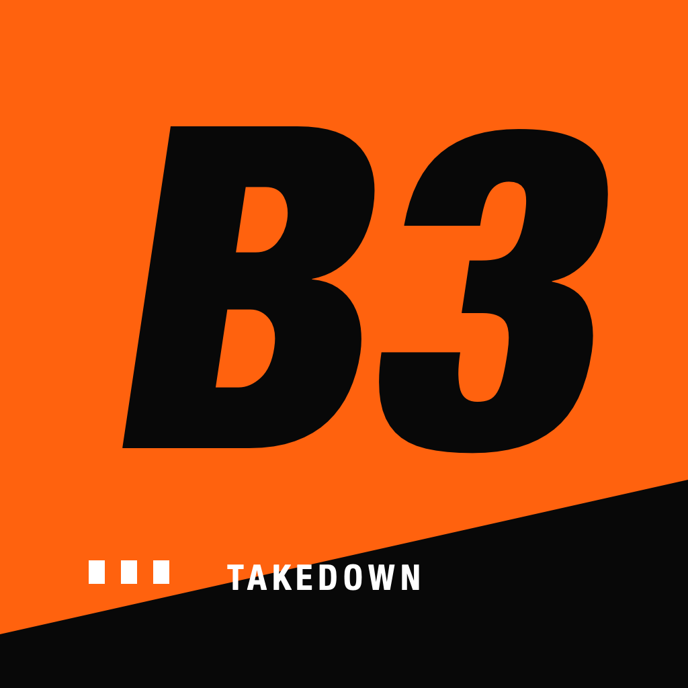

# Burnout 3 iOS

An experimental native iOS port of **Burnout 3: Takedown**, based on the
**USA original Xbox release** and adapted from [Takedawn](https://github.com/xenophobentx/takedawn)
and [xboxrecomp](https://github.com/xenophobentx/xboxrecomp).

**`main` is the Xbox-based iOS app.** The former PS2 implementation is preserved
on [ps2-legacy](https://github.com/TheMarcellVarga/burnout3-ios/tree/ps2-legacy).
The `xbox-ios` branch records the feature commits that were merged into `main`.
Use `main` for current development and builds.



The app is named **Burnout 3** and uses the exact white-and-red icon from our
older PS2 build. It has a native launcher, persistent iOS settings, a verified
Files importer, contextual touch controls and settings entries in the game’s
own settings and race pause menus. Return to the launcher and **Resume game**
preserve the current live session. The game’s Save Profile stores lasting progress.

## Current state

As of 27 October 2026, build 13 installs on an iPhone 15 Pro Max and targets
iOS 17.4 or later. Intro, menus, garage, a scripted Silver Lake Southbound race,
profile save/reload, native settings and launcher/resume have been exercised.
Seven focused host suites pass.

A short single-track sample reported 59.9–60.1 Metal presentations per second.
That is not a sustained performance guarantee. A lower-left HUD rendering defect
remains; complete races, physical touch comfort, audio quality, interruptions
and long-session thermals need more validation. This is a development prototype.
See [device evidence](ios/DEVICE_STATUS.md) and [optimization measurements](ios/OPTIMIZATION.md).

## Build and run

Use an Apple Silicon Mac with Xcode and the iOS SDK, CMake, Python 3.10 or newer,
Git, and your own extracted supported USA Xbox game folder. Game files are
supplied separately; PS2 disc images and saves do not work with this runtime.

```sh
git clone https://github.com/TheMarcellVarga/burnout3-ios.git
cd burnout3-ios
python3 tools/ios/build.py --game-dir '/path/to/Burnout 3 Takedown' --build --team YOUR_TEAM_ID
```

The build command prepares pinned runtime/SDL dependencies, checks the game
manifest, translates the executable and creates `bin/TakedawnIOS.app`.
Omit `--team` for an unsigned build check. For signing, add your Apple account
in Xcode Settings → Apple Accounts. Development signing must be renewed when
its provisioning profile expires.

Connect and unlock the iPhone and enable Developer Mode. Install with:

```sh
python3 tools/ios/build.py --build --team YOUR_TEAM_ID --device DEVICE_UDID
xcrun devicectl device process launch --device DEVICE_UDID --terminate-existing dev.burnout3.takedawn-ios
```

Import an extracted folder using the app’s Files picker, or add `--copy-game`
to the install command when supplying validated local files. Updates retain
the existing Xbox app container. Full setup and archive preparation are in the
[iOS guide](ios/README.md).

## Controls and settings

- Steer on the left; use GAS, BRAKE and BOOST on the right. Boost also holds the accelerator.
- Controls are faint at rest and brighten while held. Driving buttons show action names without Xbox correspondence badges.
- The Hybrid layout has neutral stick pickup, a floating base farther from rest, and Standard/Gentle/Quick steering choices.
- Menus use the D-pad, A to select and B to go back. Physical-controller mappings retain their existing behavior.
- **Driver Details → Settings → IOS SETTINGS**, or **IOS SETTINGS** in the race pause menu, opens the native panel.
- Display changes apply on the next app launch. Touch settings apply immediately. **Launcher → Resume game** returns to the current session.

## Tests

After preparing the runtime:

```sh
cmake -S ios/tests -B build/ios-host-checks -DCMAKE_BUILD_TYPE=Release
cmake --build build/ios-host-checks --parallel 4
ctest --test-dir build/ios-host-checks -R 'ios_session_guard|ios_menu_entry|ios_hybrid_touch|ios_mobile_preferences|ios_memory_alias|^input_touch$|mmio_decode_a64' --output-on-failure
```

The seven suites cover session ownership, guest menu injection, hybrid/original
touch input, preferences and staged imports, memory aliases and ARM64 MMIO.
The full test project also contains a Mac Metal shader compilation suite;
that does not establish iPhone rendering correctness.

## Reporting a bug

Use [this repository’s issues](https://github.com/TheMarcellVarga/burnout3-ios/issues).
Include the app build, iPhone model, iOS version, settings, mode/track and steps
to reproduce. Attach a screenshot and a reviewed `Documents/takedawn.log` when
useful; remove private paths first. Do not attach game files, generated game
code, profiles or shader caches. See [contributing](CONTRIBUTING.md).

## References and provenance

| Reference | Purpose |
| --- | --- |
| [iOS guide](ios/README.md) | Build, install, import, controls, settings and diagnostics |
| [Device status](ios/DEVICE_STATUS.md) | Bounded checks and known limitations |
| [Dependency pins](ios/dependencies.json) | Exact upstream revisions and SDL checksum |
| [Runtime patch](ios/runtime.patch) and [SDL patch](ios/sdl.patch) | Reviewable iOS adaptations |
| [Artwork provenance](ios/ASSETS.md) | The recovered original PS2 app icon |
| [Upstream README](docs/UPSTREAM_README.md) | Historical desktop/Android features, downloads and documentation |
| [PS2 legacy source](https://github.com/TheMarcellVarga/burnout3-ios/tree/ps2-legacy) | The former PS2 app and its separate history |

## Credits and licenses

The Xbox foundation is credited to Takedawn and xboxrecomp; the earlier iOS
work drew on [burnout3-pc](https://github.com/danielgomesvieira2000/burnout3-pc).
Existing code and dependency license notices are retained in [LICENSE](LICENSE)
and [THIRD_PARTY_NOTICES.md](THIRD_PARTY_NOTICES.md), and appear in the app’s
Credits & licenses screen. Artwork and game trademarks remain their owners’
property. No game data or generated game code is included in this repository.
